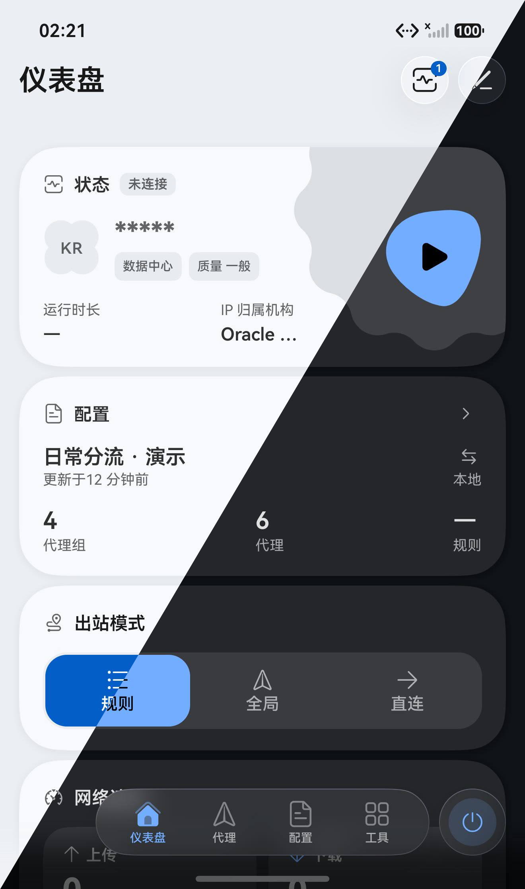

# ArkClash

[](https://github.com/VOD-Studio/ArkClash/actions/workflows/ci.yml)
[](LICENSE)

基于 mihomo 的原生 HarmonyOS NEXT 代理客户端。



## 安装

需要 **HarmonyOS 7（API 26）及以上的 ARM64 设备**。目前通过 GitHub 分发，首次安装通常需要用自己的华为开发者账号准备调试签名。[下载最新版本](https://github.com/VOD-Studio/ArkClash/releases/latest)

| 文件 | 适用于 |
|---|---|
| `ArkClash-<版本>-unsigned.hap` | 使用自己的调试签名材料签名后安装 |
| `ArkClash-<版本>-debug-signed.hap` | 仅限维护者调试 Profile 中登记的设备 |

下载后可用同一版本的 `SHA256SUMS` 校验文件。[发布包签名与安装](docs/usage.md#安装发布包)

## 首次连接

1. 打开 ArkClash，在系统弹窗中允许 VPN 授权。如果之前拒绝过，可在「代理」点「启动内核」重试。
2. 在「配置」导入订阅、节点分享链接或本地 Clash / mihomo YAML，然后选中该配置。
3. 回到仪表盘点「连接」。连接成功后，ArkClash 开始接管系统流量。

[查看进阶使用指南](docs/usage.md#配置与订阅)

## 功能

- 未连接 VPN 时也可选择节点和测速。每份配置单独记住所选节点。
- 支持扫码、从相册导入二维码、更新 age 加密订阅，也可编辑 YAML 或组装自定义配置。
- 可用附加规则和 JavaScript 覆写配置，管理本地节点库、规则集、筛选预设及代理组图标。
- 仪表盘显示实时速率、连接统计和出口 IP，支持检查连通性与应用更新。工具页提供实时连接、近期请求、DNS 查询和日志。
- 内置 Geo 数据，支持自定义下载源和自动更新。可调整 VPN 网络设置、分应用绕过和主题，并通过本地 ZIP 或 WebDAV 备份与恢复。

## 真机验证

基础 VPN 连接和代理转发已在 Pura 70 Ultra（API 26）上验证。冷启动到可操作、开代理待机 8 小时的耗电、新连接延迟和 24 小时内核稳定性暂无公开的同机对照结果。[转发验证记录](docs/adr/0013-runtime-host-process-evidence.md#验证) · [性能测量方法](docs/adr/0017-core-ready-without-vpn.md)

## 从源码构建

需要 DevEco Studio 或 Command Line Tools（带 HarmonyOS SDK API 26）、Go（版本见 `.go-version`）和 Python 3。使用 Command Line Tools 时设置 `HARMONYOS_TOOLS_HOME`。单独指定内核编译使用的 OpenHarmony SDK 时，设置 `OHOS_SDK`。

要装到手机上，先在 DevEco Studio 打开项目，通过 File → Project Structure → Signing Configs 配置自动签名，再执行以下命令。首次搭建环境可参照[配置指南](docs/agents/fork-setup.md)。

```sh
make geodata   # 下载 Geo 数据，打包进 HAP
make core      # 交叉编译 mihomo 内核
make hap       # 打包 HAP 到 dist/
make run       # 安装到连着的手机并启动
```

默认构建 ARM64。针对 x86_64 模拟器，给 `make core`、`make hap` 和 `make run` 加上 `ABI=x86_64`。不同架构需依次打包。`make help` 列出全部命令。[模拟器验证记录](docs/adr/0014-x86-emulator-toolchain.md#验证与边界)

## 文档

| 文档 | 内容 |
|---|---|
| [更新日志](CHANGELOG.md) | 各版本的功能与修复 |
| [架构](docs/architecture.md) | 进程划分、连接流程、目录分层 |
| [决策记录](docs/adr/) | 关键技术取舍和理由 |
| [CI/CD](docs/ci.md) | 流水线、密钥配置、发版流程 |
| [AGENTS.md](AGENTS.md) | 开发规范，人和 AI agent 共用 |

## 参与贡献

欢迎提 issue 和 PR，先读[贡献指南](CONTRIBUTING.md)。安全漏洞请按[安全策略](SECURITY.md)私密报告。

## 致谢

- [mihomo](https://github.com/MetaCubeX/mihomo)：代理内核
- [FlClash v0.9.3](https://github.com/chen08209/FlClash/tree/be84736605527034689c95bf27828ff27d912c5e)：交互设计参考
- [sing-tun](https://github.com/SagerNet/sing-tun) 和 [gVisor](https://github.com/google/gvisor)：TUN 协议栈
- [meta-rules-dat](https://github.com/MetaCubeX/meta-rules-dat)：内置的 Geo 数据

## 许可证

[GPL-3.0](LICENSE)

## 免责声明

本项目仅用于学习和研究网络技术。请遵守你所在地区的法律法规，使用本软件产生的后果由使用者自行承担。
