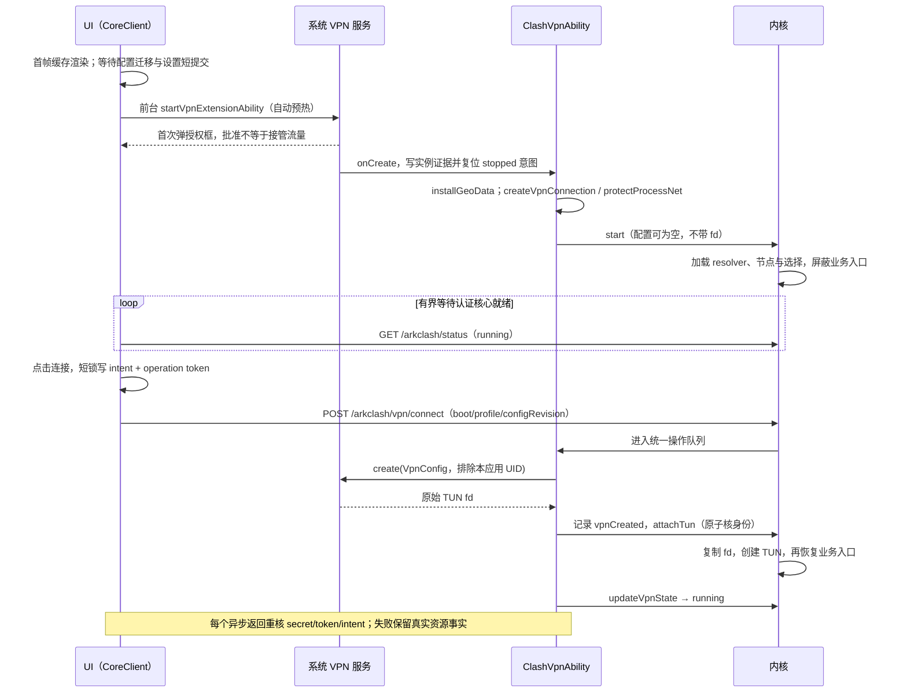

# 架构

产品目标和性能底线见 AGENTS.md「产品底线」，平台限制见 `docs/agents/platform-pitfalls.md`，关键决策的理由见 `docs/adr/`。

## 运行时结构


- **UI 进程**只做界面和控制，不加载内核。界面恢复时重新查询运行事实，不能用上次的连接缓存断言 VPN 仍存活。
- **VPN 进程**是内核的唯一宿主，可先启动无 TUN 的核心。只有连接时才创建系统 VPN 并附加 TUN；普通断开保留核心。系统销毁扩展后不承诺驻留或转发（[ADR-0017](adr/0017-core-ready-without-vpn.md)）。
- 两个进程之间只有两条通道（[ADR-0003](adr/0003-ui-core-via-external-controller.md)）：
  - **内核控制面**：mihomo external-controller 承载运行查询、节点选择、测速、规则探测、流量与事件。ArkClash 路由在 `/arkclash/` 下：Go 处理运行快照、选择事务和热切换，订阅命令经 NAPI 转给 VPN 进程的 ArkTS（[ADR-0009](adr/0009-arkclash-commands-on-controller.md)）。独立进程专用的 `PUT`/`PATCH /configs`、`/restart`、`/upgrade` 保持关闭。
  - **文件通道**：`shared/Runtime.ets` 交接启动设置、错误和停止回执；`shared/profiles/Store.ets` 保存配置列表、内容、摘要及每配置节点选择。跨进程短提交持有存储锁，下载使用独立资源任务锁，不占住提交锁等待网络。
- UI 进程通过 `protectProcessNet()` 和应用排除名单保持直连；Go 出站由 `core/socket.go` 逐 socket 绑定物理网络（[ADR-0008](adr/0008-bind-core-sockets-to-physical-network.md)）。在线出口与服务检查走 `POST /arkclash/probe`，由内核按当前规则拨号，不要求订阅开放 HTTP 代理端口；停止时用 SDK 流式直连。两条路径共用 `client/ServiceRules.ets` 的 FlClash `be847366` 服务协议，不能统一用首页 HEAD 或仅凭 HTTP 状态判断服务可用性。
- 探测请求携带目标 URL、方法、正文模式、可选目标请求头/正文与重定向策略；controller 凭据不进入目标请求，跨源跳转移除目标 Authorization，并禁止 307/308 跨源重放非空正文。UI 与内核各约束四个实际执行名额，旧请求结束才释放；单步最多 10 秒、整批服务最多 60 秒，多步检查也必须保持同一 boot/revision。
- 探测响应包含目标状态、正文片段、最终 URL、Location、响应头延迟及 boot/revision。目标 403 等状态仍放在成功的 controller 信封内，不混同 controller 的 409/429/503/504。正文按用途限制：`none` 不收集正文，`small`/`html` 保留 16/512 KiB 前缀，`json` 必须是完整的至多 64 KiB，`scan` 最多扫描 8 MiB、返回首次命中起的当前窗口（32 KiB 加 256 字节重叠），保留同窗口内优先于地区的拒绝证据，不积存整页 HTML。
- 内核取得响应头后可立即停止无正文请求或命中的扫描。SDK 直连若没有提供状态行，则必须等 `requestInStream()` 完成才能可靠取得状态码：正文收集停止后丢弃后续块，应用累计接收超过 8 MiB 或超时即失败；该数值不是包含压缩、在途数据的网络流量上限。直连延迟保留头事件时间，没有状态行时无法严格区分中间响应头与最终响应头。

## 连接流程



断开：UI 先原子写停止意图和新 token，再发 `/arkclash/vpn/disconnect`。扩展在同一队列里关闭业务入口、已接受的转发连接和 Go TUN，并独立尝试销毁系统 VPN；清理失败保留 `vpnCreated/tunAttached/listenersOpen` 与错误，不报停止成功。controller、resolver/fake-IP、节点、选择、测速结果和 scheduler 保留，boot/configRevision 不变；完整换配置才更新配置身份并取消旧测速。系统持有原 fd，Go 只持有 Linux 获取接口时复制的 `F_DUPFD_CLOEXEC` 副本；关闭失败不重复 close 可能已复用的描述符。

完整关闭仅用于扩展销毁、启动失败或明确恢复未知宿主：等待启动和操作队列收尾，分别停止核心与销毁平台 VPN，两者都成功才写 `runtime-stopped.json`。启动从等待配置短提交起由 `CoreClient` 单飞 Promise 和宿主代次保护，覆盖 runtime 已写好但系统尚未创建 VPN 进程的窗口；此时宿主查询仍为 unknown。停止回执绑定 secret+instance；系统直接杀死进程或重启没有回执时，沿用系统仅剩调用方 UI 进程的前后文件取证。controller 失联、空进程列表或查询异常均不证明停止（[ADR-0013](adr/0013-runtime-host-process-evidence.md)）。完整关闭同步退休 controller 的 HTTP/WebSocket 连接，旧流不能越过新 boot。

节点选择携带 `expectedBootId` 和配置的 `expectedRevision`。`configRevision` 只在完整配置启动或热切换提交后前进；同一配置内连续选节点不会互相使请求过期。旧配置请求在 Go 事务内拒绝，持久化失败恢复原转发目标，幂等重放返回原操作结果。

`coreReady/coreStarting` 与实际 VPN 连接分开。运行事件只在前台且核心就绪时订阅；流量、出口/服务探测和连接/DNS 诊断保留实际连接条件。首次授权拒绝后不自动重试，节点页可显式启动核心。首个配置用 `expectedProfile=""` 原子激活空核心；省略该字段才是不约束。删除最后一个配置先断开、清空运行配置，再删除文件，保留空核心。完整契约、手机驻留限制和未测性能项见 [ADR-0017](adr/0017-core-ready-without-vpn.md)。

## 状态归属

| 状态 | 归属 | 写入方 | 读取方 |
|---|---|---|---|
| 配置列表 `profiles/list.json`（订阅和配置的记录、当前配置） | 应用沙箱 | UI | UI、VPN 进程 |
| 配置内容、摘要、订阅状态（`profiles/` 下其余文件） | 应用沙箱 | 核心确实停止时 UI；核心运行时订阅由 VPN 进程更新，本地编辑由 UI 经 controller 应用后提交 | UI、VPN 进程、内核 |
| `runtime.json`（secret、协议栈、模式、LAN、VPN 意图/token） | 应用沙箱 | UI 短锁提交；扩展新实例将转发意图复位为 stopped | VPN 进程、UI |
| `core_error.txt` | 应用沙箱 | VPN 进程 | UI，读后删除 |
| `runtime-instance.json`（当前扩展实例标识） | 应用沙箱 | VPN 进程，创建资源前 | UI、VPN 进程 |
| `runtime-stopped.json`（当前扩展实例清理完成回执） | 应用沙箱 | VPN 进程，内核与 VPN 连接均释放后 | UI，核对 secret 与实例 |
| `profiles/<id>.selected.json`（每配置节点选择） | 应用沙箱 | 离线 UI；在线 Go 选择事务 | UI、内核启动及热切换 |
| Geo 数据（四类固定文件）和 `geo-<id>.json` 更新元数据 | 应用沙箱 | 在线 Go 管理器；VPN 安装器只恢复缺失或升级未接管的两份内置数据 | 内核、UI（只读文件信息） |
| `geo-settings.json`（四类 URL、自动更新与小时间隔） | 应用沙箱 | UI 串行原子保存、revision 冲突保护 | Go 启动/热应用、UI |
| `geo.version`（内置资源版本） | 应用沙箱 | VPN 安装器全部复制成功后 | VPN 安装器 |
| 用户设置（出站模式、局域网代理等） | UI 的 preferences | UI | UI |
| 运行时状态（节点选择、连接、流量、正在运行的配置） | 内核内存 | 内核 | UI，经 controller |
| 连接 recent/live 与 DNS 诊断历史 | 内核与 UI 内存，不落盘 | 对应可见订阅的内核观察 hook；UI 合并已观察的同代次历史 | 对应工具页，经独立诊断 WebSocket |

Geo 资源页使用 `/arkclash/geo`、`/arkclash/geo/settings`、`/arkclash/geo/update` 和独立 `/arkclash/geo/events` 最新值快照流。离线只读文件信息和编辑设置，页面可见且本次 boot 转发就绪后才订阅、下载；隐藏不取消内核任务。下载串行、可取消，文件与 reader/cache 原子切换，不重建 TUN。归属与 bundle 保护见 [ADR-0015](adr/0015-geo-resource-management.md)。

连接与 DNS 工具分别订阅 `/arkclash/diagnostics/connections`、`/arkclash/diagnostics/dns`，只在对应页面可见且转发就绪时采集；隐藏停止该类订阅，历史保留在内存且隐藏期间不补回。连接首帧 live 是基线，不算 recent；FindProcessOff 不变，DNS initiator 类别不是应用身份。连接 ring 2000、DNS ring 3000，每会话队列 256；溢出以 reset 补齐 canonical 状态，dropped（中间事件合并）与 evicted（历史淘汰）分开计数。多个同类订阅共用 hook/采样器，最后一个离开即撤销。协议及限制见 [ADR-0016](adr/0016-visible-diagnostics.md)。

关闭连接使用 `POST /arkclash/diagnostics/connections/close`，清理全部网络 DNS 缓存/传输使用 `POST /arkclash/diagnostics/dns/clear-cache`（不清 FakeIP 或诊断历史）。动作和订阅均以 bootId/configRevision 保护，旧代次动作在核心事务内拒绝；成功热切换在应用配置前退休会话，解析失败不动旧会话。秒级增量及有界 reset 不经过允许丢事件的通用事件通道。

同一个应用的 UI 进程和扩展进程共享模块级的 `filesDir`。preferences 只在 UI 进程里用，扩展进程需要的信息都要落到文件通道里。两个进程都会写的文件一律先写临时文件再改名（`shared/Files.ets`），同一时刻只有一方在更新订阅，交接见 ADR-0009。

## ArkTS 分层与依赖方向

| 目录 | 职责 | 可以依赖 |
|---|---|---|
| `shared/` | 两个进程共用的代码：路径、文件读写，以及订阅更新（`shared/profiles/`，[ADR-0009](adr/0009-arkclash-commands-on-controller.md)） | 系统 Kit、`yaml` |
| `client/` | UI 访问内核的唯一入口：核心预热与取证、VPN 命令、controller 请求、数据模型 | `shared/` |
| `features/<功能>/` | 一个功能的状态、页面片段和组件（订阅、代理组、连接、日志、设置） | `client/`、`shared/`、`components/` |
| `components/` | 跨功能复用的界面组件，不带业务逻辑 | `shared/` |
| `pages/` | 路由入口，只负责把 feature 组装成页面 | 上面所有 UI 层 |
| `entryability/` | UI 进程入口 | `pages/` |
| `vpn/` | VPN 进程：核心宿主、可选 TUN、Geo、核心运行期间的订阅更新与统一命令队列 | `shared/`、`libarkclash.so` |

规则：

- UI 层（除 `vpn/` 外的目录）不 import `vpn/`，也不 import `libarkclash.so`。
- `vpn/` 不 import 任何 UI 层目录。
- feature 之间不直接 import；被第二个 feature 用到的东西上提到 `components/`、`client/` 或 `shared/`。
- `components/` 第一次有实际内容时再建目录。
- 这些规则由 `scripts/check-arch.py` 检查（`make lint`）；新增目录时同时更新本表和脚本里的 `ALLOWED`。

## 内核层（Go）

| 文件 | 职责 |
|---|---|
| `core/lib.go` | 导出的 C ABI（`arkclash.h`），不包含生命周期实现 |
| `core/lifecycle.go` | 唯一核心状态、无 TUN 启动、attach/detach、热切换及 `applyOverrides` |
| `core/inbound.go` | 最小业务入口设置、应用前屏蔽、恢复与真实资源校验 |
| `core/api.go` | controller 上的 `/arkclash/` 路由、转给 ArkTS 的命令、事件推送、经内核下载 |
| `core/runtime.go` | 原子运行快照、boot/revision 与事件 |
| `core/selection.go` | 幂等选择、原子保存、持久化失败补偿、转发前恢复 |
| `core/delay.go` | 8 执行槽测速、请求取消与配置代次隔离 |
| `core/probe.go` | 按当前规则执行出口/服务探测，共用内核证书信任 |
| `core/geo_settings.go` | Geo 磁盘设置契约、固定路径和更新元数据 |
| `core/geo.go`、`geo_download.go`、`geo_events.go` | Geo 串行更新、可取消调度、候选校验/安全提交与最新快照推送 |
| `core/diagnostics.go` | 可见订阅 registry、运行代次校验、会话背压与连接/DNS 动作事务 |
| `core/diagnostics_connections.go`、`diagnostics_dns.go` | 仅订阅期间运行的观察 collector、不可变 DTO、有界历史与收尾累计量采样 |
| `core/diagnostics_stream.go` | 独立诊断 WebSocket、控制帧、整帧写锁、deadline 与订阅清理 |
| `core/prefetch.go` | 在后台预先下载配置里的 rule-provider，第一次热切换不用等 |
| `core/tun.go` | 独立持有平台 TUN 的 Go listener；副本 fd 获取与回滚见 mihomo 补丁 |
| `core/socket.go` | 通过 Network Kit 原生 API 保护 Go 出站 socket，绑定失败则拒绝拨号 |
| `core/hilog.go` | 内核日志转发到 hilog |
| `core/loopback.go` | 关闭回环检测（原因见 platform-pitfalls 第 4 条） |

TUN 由 `tun.go` 单独持有，不走配置文件，所以热切换不重建它。detached 启动和热切换在 `executor.ApplyConfig` 前屏蔽业务入口；连接时只恢复入口，不重新应用整个配置或重建 resolver。controller 只随完整宿主生命周期启停（[ADR-0010](adr/0010-hot-switch-reload-in-vpn.md)、[ADR-0017](adr/0017-core-ready-without-vpn.md)）。

## 构建产物

```
core/ ── scripts/build-core.sh（补丁版 Go + OHOS NDK）──► entry/libs/<ABI>/libclash.so
Geo 数据 ── scripts/fetch-geodata.sh ──► entry/src/main/resources/rawfile/geo/
entry/ ── hvigor（CMake 编 NAPI 桥 + ArkTS）──► HAP
```

`ABI` 默认为 `arm64-v8a`，可选 `x86_64`。私有工具链和补丁依赖按 ABI 隔离；HAP 只包含所选架构的内核与 NAPI 桥。ARM64 包名保持不变，x86_64 包名增加 `-x86_64`；两种 dist 产物共存，但共享 Hvigor 中间目录，不能并发打包。签名前可用 `make core-smoke ABI=x86_64` 在已连接的模拟器验证动态加载与多线程 C API；这不替代应用内 VPN 验收。原理与验证边界见 [ADR-0014](adr/0014-x86-emulator-toolchain.md)。

## 后续演进的约束

- **provider 预下载**：热切换要等新配置的 provider 全部加载完。`core/prefetch.go` 在后台预先下载 rule-provider，触发方是 VPN 进程（订阅更新后、连接 10 秒后）和界面（连接中导入本地配置后，经 `POST /arkclash/prefetch`）。proxy-provider 不预下载（原因见 ADR-0010）。
- **新的 ArkClash 命令**：挂在 `core/api.go` 的 `/arkclash/` 下。内核自己能完成的由 Go 处理；要用到 ArkTS 侧逻辑的，走 `/arkclash/profiles/{name}` 这类转发路由（ADR-0009）。
- **VpnConfig 级设置**（协议栈、IPv6、分应用代理、VpnConfig 里的 DNS 地址和 MTU）不能热切换，改了只能断开重连（ADR-0010）。
- **分应用代理**：`VpnConfig` 的 `trustedApplications` 和 `blockedApplications` 互斥。"只代理这些应用"用 trusted 列表，本应用不在列表里，自然被排除；"绕过这些应用"用 blocked 列表，列表里必须始终带上本应用（[ADR-0004](adr/0004-exclude-self-by-uid.md)）。
- **流量与连接**：用 controller 的 WebSocket（`/traffic`、`/connections`、`/logs`）推送，规则见 `docs/agents/ui.md`「性能」。
- **IPv6**：要同时给 `VpnConfig` 加 IPv6 地址和路由，给 `tun.go` 加 `Inet6Address`，两边一起改。
