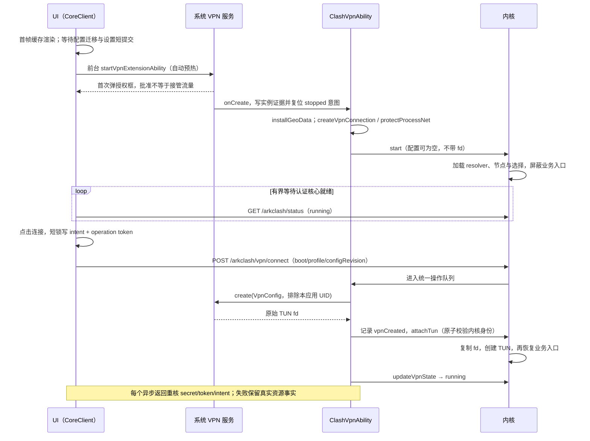

# 架构

产品目标和性能底线见 AGENTS.md「产品底线」，平台限制见 `docs/agents/platform-pitfalls.md`，关键决策的理由见 `docs/adr/`。

## 运行时结构


- **UI 进程**只做界面和控制，不加载内核。界面恢复时重新查询运行事实，不能用上次的连接缓存断言 VPN 仍存活。
- **VPN 进程**是内核的唯一宿主，可先启动无 TUN 的核心。只有连接时才创建系统 VPN 并附加 TUN；普通断开保留核心。系统销毁扩展后不承诺驻留或转发（[ADR-0017](adr/0017-core-ready-without-vpn.md)）；已连接时宿主被回收、没有留下停止回执的，回到前台、内核就绪后恢复一次连接（[ADR-0037](adr/0037-resume-after-vpn-reclaim.md)）。
- UI 在宿主运行时绑定 VPN 扩展，扩展回收优先级随 UI 降为 UI 加 100；绑定不传数据，断开回调用作宿主退出信号，前台立即恢复连接。用户开启「后台保持连接」时，UI 连接期间持有数据传输长时任务，后台也立即恢复（[ADR-0038](adr/0038-bind-vpn-host-and-background-keep.md)）。
- 两个进程之间只有两条通道（[ADR-0003](adr/0003-ui-core-via-external-controller.md)）：
  - **内核控制面**：mihomo external-controller 承载运行查询、节点选择、测速、规则探测、流量与事件。ArkClash 路由在 `/arkclash/` 下：Go 处理运行快照、选择事务和热切换，订阅命令经 NAPI 转给 VPN 进程的 ArkTS（[ADR-0009](adr/0009-arkclash-commands-on-controller.md)）。独立进程专用的 `PUT`/`PATCH /configs`、`/restart`、`/upgrade` 保持关闭。
  - **文件通道**：`shared/Runtime.ets` 交接启动设置、错误和停止回执；`shared/profiles/Store.ets` 保存配置列表、内容、摘要及每配置节点选择。跨进程短提交持有存储锁，下载使用独立资源任务锁，不占住提交锁等待网络。
- 配置覆写脚本与绑定保存在 `profiles/scripts.json`，由 UI 和 VPN 扩展在配置存储锁下提交。运行中的脚本和规则修订随状态推送，已保存修订通过认证的 `/arkclash/scripts/apply` 应用。订阅和普通本地配置先执行已选 QuickJS 脚本，再合并附加规则。结构化自定义配置使用自身的规则。两种路径都经 `applyOverrides` 应用平台、常规和 DNS 设置。参见 [ADR-0023](adr/0023-profile-scripts-in-vpn.md)、[ADR-0030](adr/0030-composed-overrides-and-live-status.md) 和 [ADR-0032](adr/0032-structured-custom-profile.md)。
- UI 进程通过 `protectProcessNet()` 和应用排除名单保持直连；Go 出站由 `core/internal/platform/socket.go` 逐 socket 绑定物理网络（[ADR-0008](adr/0008-bind-core-sockets-to-physical-network.md)）。在线出口与服务检查走 `POST /arkclash/probe`，由内核按当前规则拨号，不要求订阅开放 HTTP 代理端口；停止时用 SDK 流式直连。两条路径共用 `client/ServiceRules.ets` 的 FlClash `be847366` 服务协议，不能统一用首页 HEAD 或仅凭 HTTP 状态判断服务可用性。
- 探测请求携带目标 URL、方法、正文模式、可选目标请求头/正文与重定向策略；controller 凭据不进入目标请求，跨源跳转移除目标 Authorization，并禁止 307/308 跨源重放非空正文。UI 与内核各约束四个实际执行名额，旧请求结束才释放；单步最多 10 秒、整批服务最多 60 秒，多步检查也必须保持同一 boot/revision。
- 探测响应包含目标状态、正文片段、最终 URL、Location、响应头延迟及 boot/revision。目标 403 等状态仍放在成功的 controller 信封内，不混同 controller 的 409/429/503/504。正文按用途限制：`none` 不收集正文，`small`/`html` 保留 16/512 KiB 前缀，`json` 必须是完整的至多 64 KiB，`scan` 最多扫描 8 MiB、返回首次命中起的当前窗口（32 KiB 加 256 字节重叠），保留同窗口内优先于地区的拒绝证据，不积存整页 HTML。
- 内核取得响应头后可立即停止无正文请求或命中的扫描。SDK 直连若没有提供状态行，则必须等 `requestInStream()` 完成才能可靠取得状态码：正文收集停止后丢弃后续块，应用累计接收超过 8 MiB 或超时即失败；该数值不是包含压缩、在途数据的网络流量上限。直连延迟保留头事件时间，没有状态行时无法严格区分中间响应头与最终响应头。

## 连接流程



断开：UI 先原子写停止意图和新 token，再发 `/arkclash/vpn/disconnect`。扩展在同一队列里关闭业务入口、已接受的转发连接和 Go TUN，并独立尝试销毁系统 VPN；清理失败保留 `vpnCreated/tunAttached/listenersOpen` 与错误，不报停止成功。controller、resolver/fake-IP、节点、选择、测速结果和 scheduler 保留，boot/configRevision 不变；完整换配置才更新配置身份并取消旧测速。系统持有原 fd，Go 只持有 Linux 获取接口时复制的 `F_DUPFD_CLOEXEC` 副本；关闭失败不重复 close 可能已复用的描述符。

完整关闭仅用于扩展销毁、启动失败或明确恢复未知宿主：等待启动和操作队列收尾，分别停止核心与销毁平台 VPN，两者都成功才写 `runtime-stopped.json`。启动从等待配置短提交起由 `CoreClient` 单飞 Promise 和宿主代次保护，覆盖 runtime 已写好但系统尚未创建 VPN 进程的窗口；此时宿主查询仍为 unknown。停止回执绑定 secret+instance；系统直接杀死进程或重启没有回执时，沿用系统仅剩调用方 UI 进程的前后文件取证。controller 失联、空进程列表或查询异常均不证明停止（[ADR-0013](adr/0013-runtime-host-process-evidence.md)）。完整关闭同步退休 controller 的 HTTP/WebSocket 连接，旧流不能越过新 boot。

节点选择携带 `expectedBootId` 和配置的 `expectedRevision`。`configRevision` 只在完整配置启动或热切换提交后前进；同一配置内连续选节点不会互相使请求过期。旧配置请求在 Go 事务内拒绝，持久化失败恢复原转发目标，幂等重放返回原操作结果。

`coreReady/coreStarting` 与实际 VPN 连接分开。前台且核心就绪时订阅运行事件。VPN 接通后订阅转发流量，出口和服务探测则随连接状态选择内核或系统网络。诊断采集跟随应用级接收端与已认证的核心。首次授权拒绝后可在代理页显式启动内核。首个配置用 `expectedProfile=""` 原子激活空核心，省略该字段时不约束当前配置。删除最后一个配置先断开、清空运行配置，再删除文件，保留空核心。完整契约、手机驻留限制和未测性能项见 [ADR-0017](adr/0017-core-ready-without-vpn.md)。

## 状态归属

| 状态 | 归属 | 写入方 | 读取方 |
|---|---|---|---|
| 配置列表 `profiles/list.json`（订阅和配置的记录、当前配置） | 应用沙箱 | UI | UI、VPN 进程 |
| 配置内容、摘要、订阅状态（`profiles/` 下其余文件） | 应用沙箱 | 核心确实停止时 UI；核心运行时订阅由 VPN 进程更新，本地编辑由 UI 经 controller 应用后提交 | UI、VPN 进程、内核 |
| `runtime.json`（secret、本次连接的网络设置和应用排除名单、模式、LAN、VPN 意图/token） | 应用沙箱 | UI 短锁提交，改写前读取上次意图以决定是否恢复连接；扩展新实例将转发意图复位为 stopped | VPN 进程、UI |
| `core_error.txt` | 应用沙箱 | VPN 进程 | UI，读后删除 |
| `runtime-instance.json`（当前扩展实例标识） | 应用沙箱 | VPN 进程，创建资源前 | UI、VPN 进程 |
| `runtime-stopped.json`（当前扩展实例清理完成回执） | 应用沙箱 | VPN 进程，内核与 VPN 连接均释放后 | UI，核对 secret 与实例 |
| `profiles/<id>.selected.json`（每配置节点选择） | 应用沙箱 | 离线 UI；在线 Go 选择事务 | UI、内核启动及热切换 |
| Geo 数据（四类固定文件）和 `geo-<id>.json` 更新元数据 | 应用沙箱 | 在线 Go 管理器；VPN 安装器只恢复缺失或升级未接管的两份内置数据 | 内核、UI（只读文件信息） |
| `geo-settings.json`（四类 URL、自动更新与小时间隔） | 应用沙箱 | UI 串行原子保存、revision 冲突保护 | Go 启动/热应用、UI |
| `dns-overrides.json`（用户选中的全局 DNS 覆写项） | 应用沙箱 | 在线由 Go 原子提交，核心确认停止时由 UI 短锁提交 | Go 启动/热应用、UI |
| `general-settings.json`（端口、认证、Hosts、订阅 UA、追加系统 DNS、连接和日志设置） | 应用沙箱 | 在线由 Go 提交，核心确认停止时由 UI 短锁提交 | Go、UI、VPN |
| `added-rules.json`（全局和配置级附加规则） | 应用沙箱 | 在线由 Go 原子提交，核心确认停止时由 UI 短锁提交 | Go 启动/热应用、UI |
| `rule-sets.json`、`rule-sets/`（规则集目录、源文件和编译内容） | 应用沙箱 | VPN 进程校验和提交，UI 暂存本地导入内容 | Go 启动/热应用、UI |
| `profiles/local-proxies.json`（自定义代理库） | 应用沙箱 | UI 配置文件锁、原子提交及修订检查 | UI |
| `profiles/proxy-filters.json`（筛选预设） | 应用沙箱 | UI 配置文件锁、原子提交及修订检查 | UI |
| `profiles/icon-sets.json`（图标集目录及图标地址） | 应用沙箱 | 本地由 UI 提交，连接时的 URL 同步由 VPN 进程下载并提交 | UI、VPN |
| `geo.version`（内置资源版本） | 应用沙箱 | VPN 安装器全部复制成功后 | VPN 安装器 |
| 用户设置（出站模式、局域网代理、后台保持连接等） | UI 的 preferences | UI | UI |
| 应用更新设置和临时 HAP | UI 的 `app-update` preferences 与缓存 | UI、系统下载服务 | UI |
| 应用主题（深浅色、色板、导航及字体） | UI 的 `appearance` preferences | UI | UI；不进入 VPN 进程 |
| 运行时状态（节点选择、连接、流量、正在运行的配置） | 内核内存 | 内核 | UI，经 controller |
| 连接 recent/live 与 DNS 诊断历史 | 内核与 UI 内存，不落盘 | 内核观察 hook 写入有界历史，应用级接收端维持采集 | 对应工具页，经独立诊断 WebSocket |

Geo 资源页使用 `/arkclash/geo`、`/arkclash/geo/settings`、`/arkclash/geo/update` 和独立 `/arkclash/geo/events` 最新值快照流。离线只读文件信息和编辑设置，页面可见且本次 boot 转发就绪后才订阅、下载；隐藏不取消内核任务。下载串行、可取消，文件与 reader/cache 原子切换，不重建 TUN。归属与 bundle 保护见 [ADR-0015](adr/0015-geo-resource-management.md)。

运行中 Provider 管理使用 `/arkclash/providers`、`/arkclash/providers/events`、`/arkclash/providers/update` 与 `/arkclash/providers/replace`，按 `(kind, name)` 唯一区分同名 `proxy-provider` 与 `rule-provider`，所有操作均带 `bootId` 与 `configRevision` 核对并按单项互斥；本地替换文件由 UI 暂存到 `profile-work/`，校验通过后才原位写入并生效。代理节点入库通过 `POST /arkclash/proxies/definition` 按节点实例 `id`（而非显示名）提取原始定义，再走自定义代理库校验与存储流程。

全局 DNS 由 `applyOverrides` 在解析配置时逐项合并，再按常规设置补入 `system://`。在线保存使用 `/arkclash/dns/settings`，在原有控制器和 TUN 上应用配置。设置页读取本地设置文件，DNS 记录页通过诊断接口读取数据。见 [ADR-0021](adr/0021-global-dns-overrides.md) 和 [ADR-0034](adr/0034-harmonyos-system-dns.md)。

常规设置通过 `/arkclash/general/settings` 提交。用户启用的面板单独使用 `127.0.0.1:9090`，密钥与内部通道独立。开启日志捕获后，内核按 boot 生命周期持续将最近 5000 条结构化脱敏日志留在内存，热切换和离页不丢失；日志页可见时订阅 `/arkclash/diagnostics/logs`（按 `expectedBootId` 校验），可通过 `POST /arkclash/diagnostics/logs/clear` 清空。见 [ADR-0029](adr/0029-general-settings-and-log-capture.md) 与 [ADR-0039](adr/0039-boot-scoped-structured-logs.md)。

附加规则在线保存使用 `/arkclash/rules/settings`。按配置级规则、启用的全局规则、脚本输出中的规则顺序合并，未选脚本时最后一层来自源配置。配置级规则和命名出口保存后在覆写页应用，或随下次配置加载生效。全局规则变更只有影响当前已应用的规则时才热应用。仪表盘可见时订阅 Geo 下载进度。应用版本检查在首次前台显示后异步触发，也可从仪表盘手动发起。应用更新使用 UI 进程的系统接口。见 [ADR-0030](adr/0030-composed-overrides-and-live-status.md)。

自定义规则集通过 `/arkclash/rule-sets` 保存和同步。内核只加载附加规则明确引用的规则集，使用稳定 ID 将规则集加入相应的运行配置。见 [ADR-0025](adr/0025-managed-rule-sets.md)。

自定义代理库通过认证的 `/arkclash/local-proxies/{operation}` 在 VPN 进程编解码分享链接和校验节点定义。表单和库快照由 UI 管理。见 [ADR-0024](adr/0024-local-proxy-library.md)。

筛选预设由 UI 保存，表达式通过 `/arkclash/proxy-filters/validate` 交给 mihomo 使用的正则引擎校验。选用预设后，表达式追加到当前配置草稿的 `filter` 或 `exclude-filter` 字段。见 [ADR-0026](adr/0026-proxy-filter-presets.md)。

图标集经文件或 URL 导入。VPN 转发就绪时通过 `/arkclash/profiles/icon-set-download` 按当前规则下载清单。代理组的图标地址写入配置草稿的 `icon` 字段，由现有的代理页和仪表盘显示。见 [ADR-0027](adr/0027-icon-set-library.md)。

`/arkclash/diagnostics/capture` 是随 UI 接收端存活的应用级采集通道，不传记录；仪表盘「连接统计」卡片可见时订阅轻量的 `/arkclash/diagnostics/stats`，仅推送活跃连接、最近请求和 DNS 查询三项计数（至多 1Hz、无变化不发帧，不触发连接流量采样）。连接与 DNS 工具只在页面可见、应用在前台且核心就绪时分别订阅 `/arkclash/diagnostics/connections`、`/arkclash/diagnostics/dns`；重新打开读取同代次完整有界历史，包括此前离页和后台期间的记录。连接首帧 live 基线不算 recent；FindProcessOff 不变，DNS initiator 不是应用身份。连接 ring 2000、DNS ring 3000，页面会话队列 256；溢出以 reset 补齐，dropped（会话内中间事件合并）与 evicted（历史淘汰）分开计数。详见 [ADR-0019](adr/0019-app-diagnostics-capture.md)。

关闭连接使用 `POST /arkclash/diagnostics/connections/close`，清理全部网络 DNS 缓存/传输使用 `POST /arkclash/diagnostics/dns/clear-cache`（不清 FakeIP 或诊断历史）。动作和页面流均以 bootId/configRevision 保护，旧代次动作在核心事务内拒绝；成功热切换退休旧数据会话与历史，不关闭绑定 bootId 的采集通道。普通 VPN 断开保留同代次历史。秒级增量及有界 reset 不经过允许丢事件的通用事件通道。

同一个应用的 UI 进程和扩展进程共享模块级的 `filesDir`。preferences 只在 UI 进程里用，扩展进程需要的信息都要落到文件通道里。两个进程都会写的文件一律先写临时文件再改名（`shared/Files.ets`），同一时刻只有一方在更新订阅，交接见 ADR-0009。

备份入口在 `features/backup/`，归档及网络编排在 `client/BackupService.ets`，共享数据契约在
`shared/backup/`。独立的 `libarkstore.so` 在后台执行归档与原子目录交换，和 VPN 内核不链接。
ZIP 快照与恢复机制、旧版目录兼容及 WebDAV 路由见 [ADR-0031](adr/0031-portable-backup.md)。

## ArkTS 分层与依赖方向

| 目录 | 职责 | 可以依赖 |
|---|---|---|
| `shared/` | 两个进程共用的代码：路径、文件读写，以及订阅更新（`shared/profiles/`，[ADR-0009](adr/0009-arkclash-commands-on-controller.md)） | 系统 Kit、`yaml` |
| `client/` | UI 访问内核的唯一入口：核心预热与取证、VPN 命令、controller 请求、数据模型 | `shared/` |
| `features/<功能>/` | 一个功能的状态、页面片段和组件（订阅、代理组、连接、日志、设置） | `client/`、`shared/`、`components/` |
| `components/` | 跨功能复用的界面组件及 UI 专属外观状态，不带网络或代理业务逻辑 | `shared/` |
| `pages/` | 路由入口，只负责把 feature 组装成页面 | 上面所有 UI 层 |
| `entryability/` | UI 进程入口 | `pages/` |
| `vpn/` | VPN 进程：核心宿主、可选 TUN、Geo、核心运行期间的订阅更新与统一命令队列 | `shared/`、`libarkclash.so` |

规则：

- UI 层（除 `vpn/` 外的目录）不 import `vpn/`，也不 import `libarkclash.so`。
- `vpn/` 不 import 任何 UI 层目录。
- feature 之间不直接 import；被第二个 feature 用到的东西上提到 `components/`、`client/` 或 `shared/`。
- 这些规则由 `scripts/check-arch.py` 检查（`make lint`）；新增目录时同时更新本表和脚本里的 `ALLOWED`。

## 内核层（Go）

`core/` 根目录保持零 `.go` 文件，所有入口位于 `core/cmd/`，内部实现按 5 层单向 DAG 收口在 `core/internal/`（详见 [ADR-0044](adr/0044-core-cmd-and-five-layer-internal-dag.md)）：

| 路径 | 层级 | 职责 |
|---|---|---|
| `core/cmd/clash/lib.go` | L0 入口 | `//go:build ohos`：`libclash.so` 唯一 C ABI 入口（全部 16 个 `ArkClash*` 导出符号）、平台日志回调装配与 `api.InstallOnce` 初始化，不直接访问核心状态或锁 |
| `core/cmd/backupstore/main.go` | L0 入口 | `libarkstore_impl.so` 独立备份库入口（`ArkStoreRun`/`ArkStoreFree`），仅依赖 `internal/backup`，零 mihomo 依赖 |
| `core/internal/api/` | L1 控制面 | 零 `init()`：显式 `Mount(chi.Router)` 装配全部 `/arkclash/*` 路由、进程级幂等 `InstallOnce(eng)` 与跨进程存储锁路由中间件 |
| `core/internal/engine/` | L2 核心引擎 | 唯一持有 `lifecycle` 与 `mu` 锁的 `Engine` 状态机：无 TUN 启动/热切换/回滚事务（`ReloadTx`）、业务入口与 `TunHandle`、`127.0.0.1:9090` 外部面板、代理身份表、幂等节点选择、8 槽测速取消、Tailscale 登录、未变 `rule-provider` 复用与 `WithPortableMutation` 锁守卫 |
| `core/internal/config/` | L3 配置域 | 零核心锁配置域：`StartOptions`、`ApplyOverrides` 与只读预览组装、常规/DNS/附加规则/规则集/QuickJS 脚本设置与自定义代理/筛选正则校验 |
| `core/internal/providers/` | L4 子系统 | 零核心锁的运行中 Provider 管理、单飞更新、本地校验替换与快照推送（依赖 `ctrl`、`ruleset`） |
| `core/internal/probe/` | L4 子系统 | 按当前规则执行出口与服务探测、4 槽并发控制、正文窗口扫描与跨源重定向隔离（依赖 `ctrl`、`ruletunnel`） |
| `core/internal/subfetch/` | L4 子系统 | 经内核规则下载、age 订阅解密与后台 `rule-provider` 预取（依赖 `ruletunnel`） |
| `core/internal/diagnostics/` | L4 子系统 | 应用级连接/DNS/日志有界采集、日志脱敏格式化、诊断 WebSocket 流、仪表盘轻量统计与动作事务（依赖 `ctrl`） |
| `core/internal/geo/` | L4 子系统 | Geo 磁盘设置契约、串行可取消调度、候选校验/安全热换与最新快照推送（依赖 `backup`、`ctrl`、`ruletunnel`） |
| `core/internal/backup/` | L5 基础层 | ZIP 备份、原子目录交换与 WebDAV 客户端（零 mihomo 依赖，`CGO_ENABLED=0`） |
| `core/internal/script/` | L5 基础层 | QuickJS 配置覆写脚本沙箱与执行限额（零 mihomo 依赖） |
| `core/internal/ctrl/` | L5 基础层 | controller 错误信封、原生 WebSocket 帧写入、运行时事件总线与命令分发桥（零 mihomo 依赖） |
| `core/internal/proxylink/` | L5 基础层 | 分享链接与代理配置编解码纯引擎（零磁盘、零网络） |
| `core/internal/ruleset/` | L5 基础层 | 规则集标识校验、格式识别、MRS 编译校验与可移植性检查纯引擎 |
| `core/internal/ruletunnel/` | L5 基础层 | 共用内核当前规则与证书信任的底层拨号与传输辅助（`DialRule`、`NewRuleTransport`） |
| `core/internal/platform/` | L5 平台层 | `//go:build ohos` 平台钩子（`hilog`、`socket`、`system_dns`、`loopback`、`tailscale_network`）与纯 Go `tailscale_watch` 状态机，零 `internal/*` 依赖 |

TUN 由 `core/internal/engine/tun.go` 单独持有，不走配置文件，所以热切换不重建它。detached 启动和热切换在 `executor.ApplyConfig` 前屏蔽业务入口；连接时只恢复入口，不重新应用整个配置或重建 resolver。controller 只随完整宿主生命周期启停（[ADR-0010](adr/0010-hot-switch-reload-in-vpn.md)、[ADR-0017](adr/0017-core-ready-without-vpn.md)）。

内核的零根 `.go` 文件、`ohos` 标签隔离、Cgo 边界、`cmd/` 与 `internal/*` 5 层单向无环 DAG 白名单、零 mihomo 隔离边界、全包 `init()` / `//export` / 包级变量白名单与核心锁仅限 `core/internal/engine/engine.go` 访问由 `scripts/ci/check-core-arch/main.go`（附 `main_test.go` 负向单测）在 `make lint CHECKS=go` 中强制校验；全内核锁序严格单向为 `lifecycle -> eng.mu -> {providers.mu, geo.mu, diag.mu -> collector.mu -> statsMu}`。宿主回归与竞态检测直接在 `core/` 原地通过 `make test TESTS=core` 与 `CORE_RACE=1` 运行（[ADR-0040](adr/0040-core-build-tags-and-host-tests.md)、[ADR-0041](adr/0041-core-internal-deep-modules.md)、[ADR-0042](adr/0042-core-engine-and-reload-tx.md)、[ADR-0044](adr/0044-core-cmd-and-five-layer-internal-dag.md)）。

## 构建产物

```
core/ ── scripts/core/build.sh（补丁版 Go + OHOS NDK）──► entry/libs/<ABI>/libclash.so
Geo 数据 ── scripts/geodata/fetch.sh ──► entry/src/main/resources/rawfile/geo/
entry/ ── hvigor（CMake 编 NAPI 桥 + ArkTS）──► HAP
```

`ABI` 默认为 `arm64-v8a`，可选 `x86_64`。私有工具链和补丁依赖按 ABI 隔离，每个 HAP 只包含所选架构的原生库。x86_64 安装包文件名比 ARM64 多 `-x86_64`。两种产物可共存于 `dist/`，打包时共用 Hvigor 中间目录，须依次执行。签名前可用 `make core-smoke ABI=x86_64` 在模拟器验证动态加载与多线程 C API。应用内 VPN 另行验收。见 [ADR-0014](adr/0014-x86-emulator-toolchain.md)。

## 后续演进的约束

- **rule-provider 复用**：热切换时定义没变、已加载出内容的 Domain/IPCIDR rule-provider 沿用运行中的实例，不重新解析，应用阶段不再随规则集大小变长（[ADR-0043](adr/0043-reuse-unchanged-rule-providers.md)）。
- **provider 预下载**：热切换要等新配置的 provider 全部加载完。`core/internal/subfetch/prefetch.go` 在后台预先下载 rule-provider，触发方是 VPN 进程（订阅更新后、连接 10 秒后）和界面（连接中导入本地配置后，经 `POST /arkclash/prefetch`）。proxy-provider 不预下载（原因见 ADR-0010）。
- **新的 ArkClash 命令**：挂在 `core/internal/api/api.go` 的 `/arkclash/` 下。内核自己能完成的由 Go 处理；要用到 ArkTS 侧逻辑的，走 `/arkclash/profiles/{name}` 这类转发路由（ADR-0009）。
- **VpnConfig 级设置**（协议栈、IPv6、分应用代理、VpnConfig 里的 DNS 地址和 MTU）不能热切换，改了只能断开重连（ADR-0010）。
- **网络设置**保存在 UI preferences，连接时随操作 token 写入 `runtime.json`。系统 VPN 和内核 TUN 使用同一份快照（[ADR-0020](adr/0020-vpn-network-settings.md)）。
- **应用访问控制**：支持关闭、黑名单（`blockedApplications`，上限 255，与 ArkClash 自身去重合并）与白名单（`trustedApplications`，上限 256，剔除自身且拒绝空白名单）三种模式，双名单独立保存；入口在「工具 → 设置 → 应用访问控制」及「网络」页摘要行，内置常用鸿蒙应用目录与免权限 `PasteButton` 批量导入，不在 `module.json5` 声明 `querySchemes`。[ADR-0020](adr/0020-vpn-network-settings.md)
- **流量与诊断**：流量使用 `/traffic`，应用的连接、DNS 和日志使用独立的 `/arkclash/diagnostics/` 数据流。[ADR-0019](adr/0019-app-diagnostics-capture.md) · [ADR-0029](adr/0029-general-settings-and-log-capture.md) · [ADR-0039](adr/0039-boot-scoped-structured-logs.md)
- **IPv6**：`VpnConfig` 和 `core/internal/engine/tun.go` 使用同一份网络设置快照，地址族和路由需同时生效。开启 IPv6 时，最小 MTU 为 1280。[ADR-0020](adr/0020-vpn-network-settings.md)
