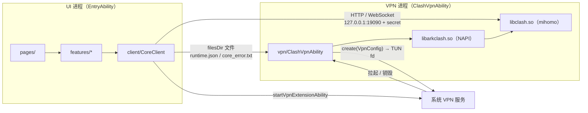
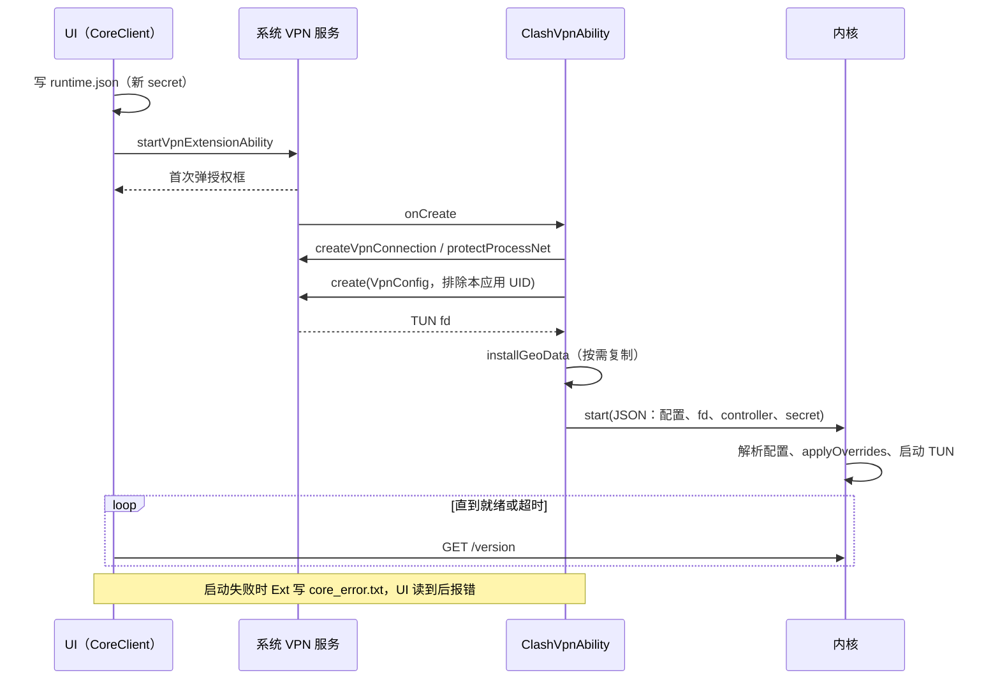

# 架构

产品目标和性能底线见 AGENTS.md「产品底线」，平台限制见 `docs/agents/platform-pitfalls.md`，关键决策的理由见 `docs/adr/`。

## 运行时结构



- **UI 进程**只做界面和控制，不加载内核。界面可以随时被系统回收，代理不受影响。
- **VPN 进程**由系统在 VPN 开启期间保活，持有 TUN fd 和内核，是代理的唯一运行位置。
- 两个进程之间只有两条通道（[ADR-0003](adr/0003-ui-core-via-external-controller.md)）：
  - **内核控制面**：mihomo 的 external-controller，所有运行时查询和操作（节点、连接、日志、流量）都走这里。
  - **文件通道**：`shared/Runtime.ets` 管理的几个文件，只用于启动前交接（配置路径、secret、协议栈）和启动失败回报。
- UI 进程通过 `protectProcessNet()` 和应用排除名单保持直连；Go 出站另由 `core/socket.go` 逐 socket 绑定当前默认物理网络，避免回到 TUN（[ADR-0008](adr/0008-bind-core-sockets-to-physical-network.md)）。需要看代理出口的功能（比如首页的出口 IP）把内核的 HTTP 代理端口（配置里的 `mixed-port` 或 `port`）当普通代理用，端口号从 controller 查。这不是控制通道；配置里没开代理端口时，这类功能显示为不可用。

## 连接流程



断开：UI 调 `stopVpnExtensionAbility`，系统回调 `onDestroy`，依次停内核、销毁 VPN 连接。

## 状态归属

| 状态 | 归属 | 写入方 | 读取方 |
|---|---|---|---|
| 订阅文件（`filesDir/profiles/`） | 应用沙箱 | UI | 内核 |
| `runtime.json`（配置路径、secret、协议栈） | 应用沙箱 | UI，每次连接前 | VPN 进程 |
| `core_error.txt` | 应用沙箱 | VPN 进程 | UI，读后删除 |
| Geo 数据（`filesDir/*.metadb、*.dat`）和版本标记 `geo.version` | 应用沙箱 | VPN 进程，安装包里的版本变了才从 rawfile 复制 | 内核 |
| 用户设置（订阅链接等） | UI 的 preferences | UI | UI |
| 运行时状态（节点选择、连接、流量） | 内核内存 | 内核 | UI，经 controller |

同一个应用的 UI 进程和扩展进程共享模块级的 `filesDir`。preferences 只在 UI 进程里用，扩展进程需要的信息都要落到文件通道里。

## ArkTS 分层与依赖方向

| 目录 | 职责 | 可以依赖 |
|---|---|---|
| `shared/` | 两个进程共用的常量、路径、文件读写 | 系统 Kit |
| `client/` | UI 访问内核的唯一入口：拉起/停止 VPN、controller 请求、数据模型 | `shared/` |
| `features/<功能>/` | 一个功能的状态、页面片段和组件（订阅、代理组、连接、日志、设置） | `client/`、`shared/`、`components/` |
| `components/` | 跨功能复用的界面组件，不带业务逻辑 | `shared/` |
| `pages/` | 路由入口，只负责把 feature 组装成页面 | 上面所有 UI 层 |
| `entryability/` | UI 进程入口 | `pages/` |
| `vpn/` | VPN 进程：TUN、内核生命周期、Geo 数据 | `shared/`、`libarkclash.so` |

规则：

- UI 层（除 `vpn/` 外的目录）不 import `vpn/`，也不 import `libarkclash.so`。
- `vpn/` 不 import 任何 UI 层目录。
- feature 之间不直接 import；被第二个 feature 用到的东西上提到 `components/`、`client/` 或 `shared/`。
- `components/` 第一次有实际内容时再建目录。
- 这些规则由 `scripts/check-arch.py` 检查（`make lint`）；新增目录时同时更新本表和脚本里的 `ALLOWED`。

## 内核层（Go）

| 文件 | 职责 |
|---|---|
| `core/lib.go` | 导出的 C API（`arkclash.h`）；`applyOverrides` 强制 ArkClash 接管的配置项 |
| `core/tun.go` | 用系统给的 fd 启动 sing-tun（gVisor 栈），独立于配置的 TUN 设置 |
| `core/socket.go` | 通过 Network Kit 原生 API 保护 Go 出站 socket，绑定失败则拒绝拨号 |
| `core/hilog.go` | 内核日志转发到 hilog |
| `core/loopback.go` | 关闭回环检测（原因见 platform-pitfalls 第 4 条） |

TUN 由 `tun.go` 单独持有，不走配置文件，所以重新加载或切换配置都不会重建 TUN（[ADR-0001](adr/0001-core-in-vpn-extension.md)）。

## 构建产物

```
core/ ── scripts/build-core.sh（补丁版 Go + OHOS NDK）──► entry/libs/arm64-v8a/libclash.so
Geo 数据 ── scripts/fetch-geodata.sh ──► entry/src/main/resources/rawfile/geo/
entry/ ── hvigor（CMake 编 NAPI 桥 + ArkTS）──► HAP
```

## 后续演进的约束

- **热切换配置**：mihomo 的 `PUT /configs` 会用配置文件里的 controller 和 TUN 设置覆盖我们的，不能直接用。需要由 VPN 进程用同一套 `applyOverrides` 重新加载。UI 到 VPN 进程目前没有命令通道，做这个功能时要先定通道方案，并写一份 ADR。
- **分应用代理**：`VpnConfig` 的 `trustedApplications` 和 `blockedApplications` 互斥。"只代理这些应用"用 trusted 列表，本应用不在列表里，自然被排除；"绕过这些应用"用 blocked 列表，列表里必须始终带上本应用（[ADR-0004](adr/0004-exclude-self-by-uid.md)）。
- **流量与连接**：用 controller 的 WebSocket（`/traffic`、`/connections`、`/logs`）推送，规则见 `docs/agents/ui.md`「性能」。
- **IPv6**：要同时给 `VpnConfig` 加 IPv6 地址和路由，给 `tun.go` 加 `Inet6Address`，两边一起改。
