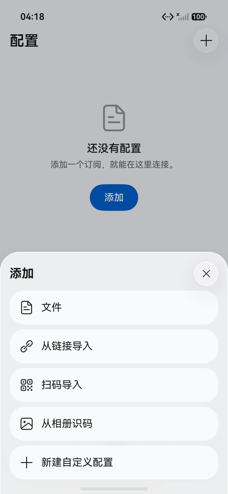
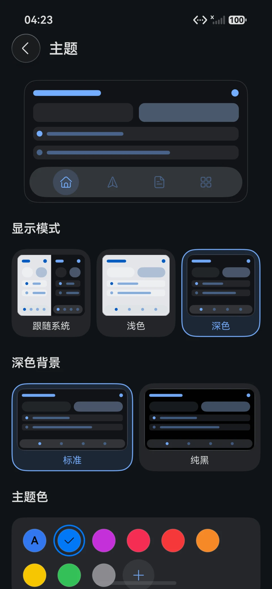

# ArkClash 使用指南

## 安装发布包

安装需要 HarmonyOS 7（API 26）及以上的 ARM64 设备。电脑需安装带 HarmonyOS SDK API 26 的 DevEco Studio 或 Command Line Tools。`hdc` 位于安装目录下的 `sdk/default/openharmony/toolchains/`，macOS 的 DevEco Studio 从应用包的 `Contents/` 目录开始找。将 `hdc` 所在目录加入 `PATH`，也可在命令中填写其完整路径。[华为 HDC 文档](https://developer.huawei.com/consumer/cn/doc/harmonyos-Guides/hdc)

从同一个发布页下载 HAP 和 `SHA256SUMS`，保留下载时的文件名。在 Linux 上可在下载目录运行 `sha256sum -c SHA256SUMS --ignore-missing`，确认下载的 HAP 显示 `OK`。其他平台可计算 HAP 的 SHA-256，并与校验文件中同名条目的值核对。[GitHub Releases](https://github.com/VOD-Studio/ArkClash/releases)

### 安装已签名 HAP

维护者发布的 `ArkClash-<版本>-debug-signed.hap` 仅适用于其调试 Profile 中已登记的设备。自行签名的 HAP 也可通过 `hdc` 安装。

1. 在设备上开启开发者模式和 USB 调试，用数据线连接电脑并同意调试授权。运行 `hdc list targets` 确认设备已连接。
2. 在电脑的下载目录运行 `hdc install -r "ArkClash-<版本>-debug-signed.hap"`，将 `<版本>` 换成发布版本号。自行签名时，填入签名输出文件的路径。

如果已解压同版本源码，也可将签名包保存为 `dist/ArkClash-<版本>-release-signed.hap`，在项目根目录运行 `make install MODE=release`。

### 给未签名 HAP 签名

校验 `ArkClash-<版本>-unsigned.hap` 后，准备调试密钥库（`.p12`）、签名证书（`.cer`）和调试 Profile（`.p7b`）。Profile 需匹配包名 `com.vodstudio.arkclash` 与签名证书，并包含目标设备的 UDID。[华为调试 Profile 指南](https://developer.huawei.com/consumer/cn/doc/App/agc-help-debug-profile-0000002248181278/)

`hap-sign-tool.jar` 位于 `hdc` 同目录下的 `lib/` 中。将示例路径、版本和密钥别名换成实际值，在终端执行并按提示输入密码。[华为命令行签名指南](https://developer.huawei.com/consumer/cn/doc/HarmonyOS-Guides/ide-hmos-command-line-building-app/)

```sh
java -jar "/path/to/hap-sign-tool.jar" sign-app \
  -mode localSign -signAlg SHA256withECDSA -compatibleVersion 26 -pwdInputMode 1 \
  -keystoreFile "/path/to/debug.p12" -keyAlias "debugKey" \
  -appCertFile "/path/to/debug.cer" -profileFile "/path/to/debug.p7b" \
  -inFile "/path/to/ArkClash-<版本>-unsigned.hap" \
  -outFile "ArkClash-<版本>-signed.hap"
```

用 `hdc install -r "ArkClash-<版本>-signed.hap"` 安装签名输出的 HAP。

如果账号无法为原包名申请调试 Profile，在源码的 `AppScope/app.json5` 中把 `bundleName` 改成自己的包名，再用 DevEco Studio 自动签名并构建。[从源码构建](../README.md#从源码构建)

### 其他安装与测试方式

- 小白调试助手提供图形化的 HAP 签名和安装操作。ArkClash 在 HarmonyOS 7 上通过该工具安装的流程尚待真机验证。[小白调试助手](https://github.com/likuai2010/auto-installer/releases/tag/3.1.0)
- 华为应用市场支持邀请测试和公开测试。维护者发布的测试版本上架后，用户可从邀请链接或应用市场测试专区获取。[邀请测试](https://developer.huawei.com/consumer/cn/doc/App/agc-help-appgallery-invite-test-guide-0000002292711373) · [公开测试](https://developer.huawei.com/consumer/cn/doc/App/agc-help-public-test-guide-0000002293706429)

## 配置与订阅

- 在「配置」点右上角「＋」打开「添加」。可选择「从链接导入」「文件」「扫码导入」或「从相册识码」。批量导入的节点分享链接会合成一份配置。

  

- 选择「新建自定义配置」可从空白组装，也可通过「导入配置结构」打开已有 YAML。自定义配置可编辑代理组、成员、拨号链和规则。
- 网页可以用 `clash://install-config?url=<经过 URL 编码的订阅地址>` 打开导入表单。`clashmeta` 和 `flclash` 协议也受支持，确认保存后开始下载。订阅卡片的「更多 → 订阅二维码」可展示订阅地址供扫码分享。
- 导入 age 加密订阅时，在单条链接表单填写 age 私钥。解密需要内核就绪，可先在「代理」点「启动内核」。手动或自动更新会使用已保存的私钥，可从配置编辑页更换。
- 当前订阅更新后，内核在线时会尝试热切换。切换沿用已建立的 VPN 隧道，部分旧连接可能需要重建。应用失败时保留原运行配置并显示错误。
- 内核就绪后可在「代理」选择节点，也可在连接 VPN 前对单个节点或整组执行延迟测试。普通断开会保留内核、节点选择和测试结果。

## 资源与诊断

- 在「工具 → 资源」管理 MMDB、ASN、GEOIP 和 GEOSITE。HAP 内置 MMDB 和 GEOSITE。离线可查看文件和保存设置，连接后可按项或全部下载。自动更新默认开启，间隔 24 小时。编辑页的「恢复默认」只修改草稿，保存后的地址在下次更新时使用。离开页面后下载会继续。
- 同一页面还可查看正在运行的代理集合和规则集合。连接 VPN 后可手动更新远程 Provider。内核就绪后可为支持本地替换的项目选择文件。
- 在「工具 → 连接」查看活跃连接和最近请求，可搜索、筛选、分组或关闭活跃连接。「工具 → DNS 查询」可查看查询、缓存命中和上游结果。采集通道保持连接时，离开页面或退到后台后仍会记录活动。列表在前台可见时更新，记录只保存在内存，热切换会清除旧记录。清理 DNS 缓存会保留诊断记录和 Fake-IP 映射。
- 在「工具 → 日志」开启捕获后，可筛选、暂停浏览和导出近期日志。离开日志页后停止采集。
- 在仪表盘顶部点「运行状态」，可查看内核和 Geo 下载进度，并检查、下载、校验及保存 GitHub 发布的 HAP。应用启动后会自动检查一次更新，可在「工具 → 常规」关闭。

## 进阶配置

- 在「工具 → 进阶配置 → 脚本」新建或导入 JavaScript，再从订阅或普通本地配置的「更多 → 覆写」选中脚本。`main(config)` 接收配置对象，返回结果会继续应用附加规则。结构化自定义配置在编辑器里管理自身的规则。
- 在「配置 → 更多 → 覆写 → 配置附加规则」管理单份配置的规则、选择 MATCH 目标和停用指定全局规则。添加规则时可选用或新建命名出口，再到配置的「命名出口」为它指定节点或代理组。当前配置可在覆写页立即应用，退出该页时也会应用已保存的更改。
- 在「工具 → 进阶配置 → DNS」逐项覆写上游策略、Fallback 筛选、Fake-IP 和缓存设置。移除覆写项并保存后恢复配置值。在「工具 → 进阶配置 → 网络 → 绕过 VPN 的应用」每行填写一个应用包名，重连后这些应用走系统网络。
- 在「工具 → 常规」设置入站端口和认证、局域网访问、外部控制器、订阅 User-Agent、全局 Hosts、延迟测试超时和切节点后的连接清理。「追加系统 DNS」默认关闭。开启后，配置会保留已有上游并加上当前默认网络提供的 DNS。

### 自定义资源

打开「工具 → 进阶配置」，在「自定义资源」分组中选择相应入口。

- 在「代理」维护本地节点库，支持协议表单和批量编辑分享链接。
- 在「规则集」新建规则集，或从文件和 URL 导入 YAML、Text、MRS。保存后在「附加规则」选择 `RULE-SET`、规则集和出站策略。远程规则集可手动同步。
- 在「筛选」管理正则预设。编辑配置内容时点「插入筛选」，选中代理组或代理集合，再选包含或排除匹配项，最后保存配置。
- 在「图标集」从文件或 URL 导入图标集 JSON。编辑配置文件时点「选择图标」，可给代理组选图标、输入图标 URL 或移除图标。

## 主题与备份

- 在「工具 → 主题」实时预览深浅色、纯黑、系统和自定义配色，还可调整导航栏、页签动效、沉浸光感、字体与字号。

  

- 在「工具 → 备份与恢复」导出本地 ZIP，或绑定 WebDAV 后手动上传与恢复。恢复时可选「仅配置及资源」或「全部数据」，并选择合并或覆盖。ZIP 未加密，请按敏感文件保存。
