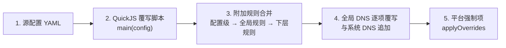

import { Aside } from '@astrojs/starlight/components';

许多时候，机场提供的订阅配置并不能完全满足个人分流习惯。ArkClash 内置了一套可组合、可预览、且对配置热切换生效的覆写管线，不需要每次更新订阅后手工改写 YAML。

## 覆写执行顺序

每次加载配置或执行热切换时，VPN 进程会按固定顺序组合各层覆写：

### 各层职责说明

1. **源配置 YAML**：来自订阅下载或本地导入的原始配置。
2. **QuickJS 覆写脚本**：若当前配置在「配置 → 更多 → 覆写」中绑定了脚本，则在 VPN 进程内执行 `main(config)`，允许以编程方式调整代理组、规则或字段。
3. **附加规则合并**：
   - 按 **配置级附加规则 → 已启用的全局附加规则 → 脚本输出规则（未选脚本时为源配置规则）** 的先后顺序合并；
   - 可在配置覆写页单独停用某条全局规则，或覆写最终的 `MATCH` 兜底出口。
4. **全局 DNS 覆写**：逐项合并你在「工具 → 进阶配置 → DNS」中显式开启的覆写项；未开启的项保留配置原值。
5. **平台强制项（`applyOverrides`）**：由内核统一强制接管以下平台关键项，确保无论订阅怎么写都能在鸿蒙上稳定工作：
   - TUN 与协议栈配置（由独立 `core/tun.go` 持有）
   - 本地 `external-controller` 地址与认证密钥
   - 进程查找开关（HarmonyOS 下关闭）
   - 节点选择持久化（关闭全局 `profile.store-selected`，改由每配置独立文件管理）
   - 用户在界面上选择的出站模式与局域网代理开关

## 应用时机与实时预览

- **配置级覆写**：在「配置 → 更多 → 覆写」保存脚本选择、配置附加规则或命名出口后，当前运行配置可直接在覆写页点击立即应用，退出覆写页时也会自动应用已保存的更改。
- **全局规则变更**：只有当修改影响到当前配置实际生效的规则集时才会触发热应用，避免不必要的重载。
- **只读运行时预览**：在配置详情中可查看合成后的**运行时完整 YAML 预览**，该预览完全只读，不会影响当前运行中的内核状态。

<Aside type="note">
  详细的设计约束与状态同步协议可查阅 [ADR-0028](../../developer/adr/0028-standard-profile-overrides/) 与 [ADR-0030](../../developer/adr/0030-composed-overrides-and-live-status/)。
</Aside>
